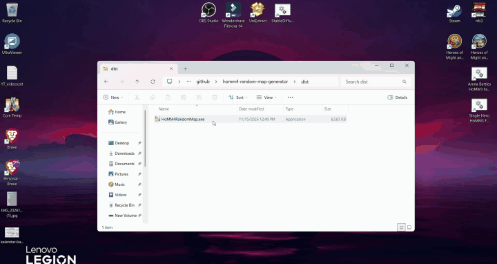
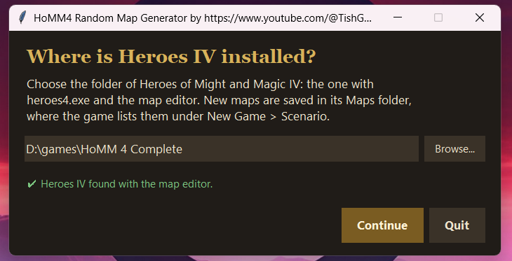
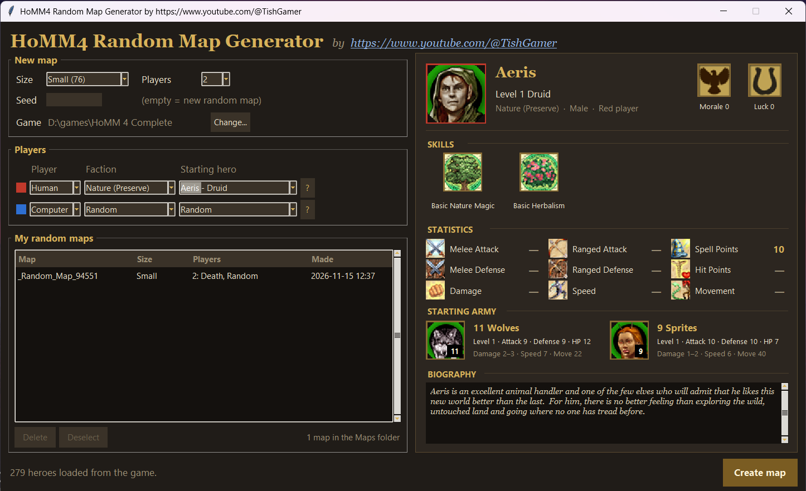
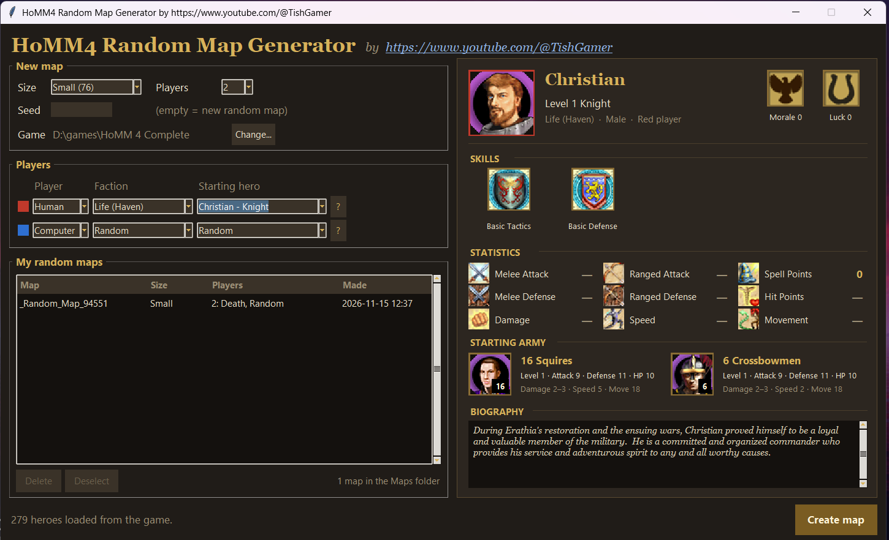
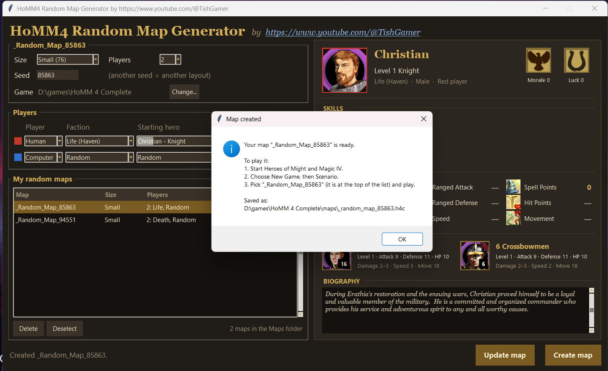
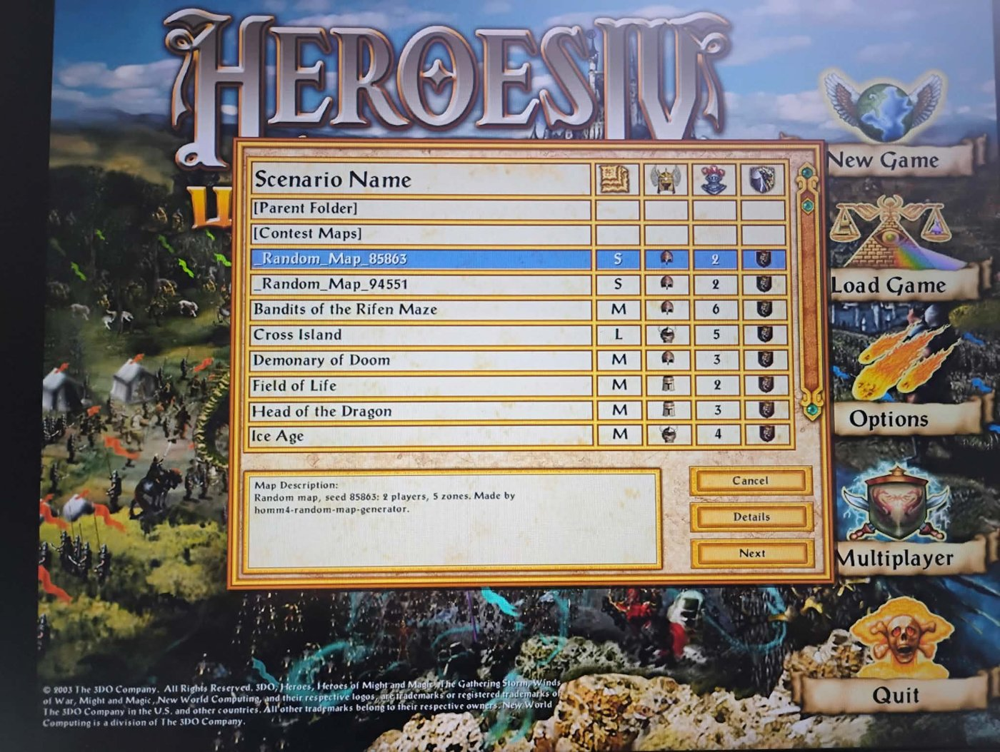
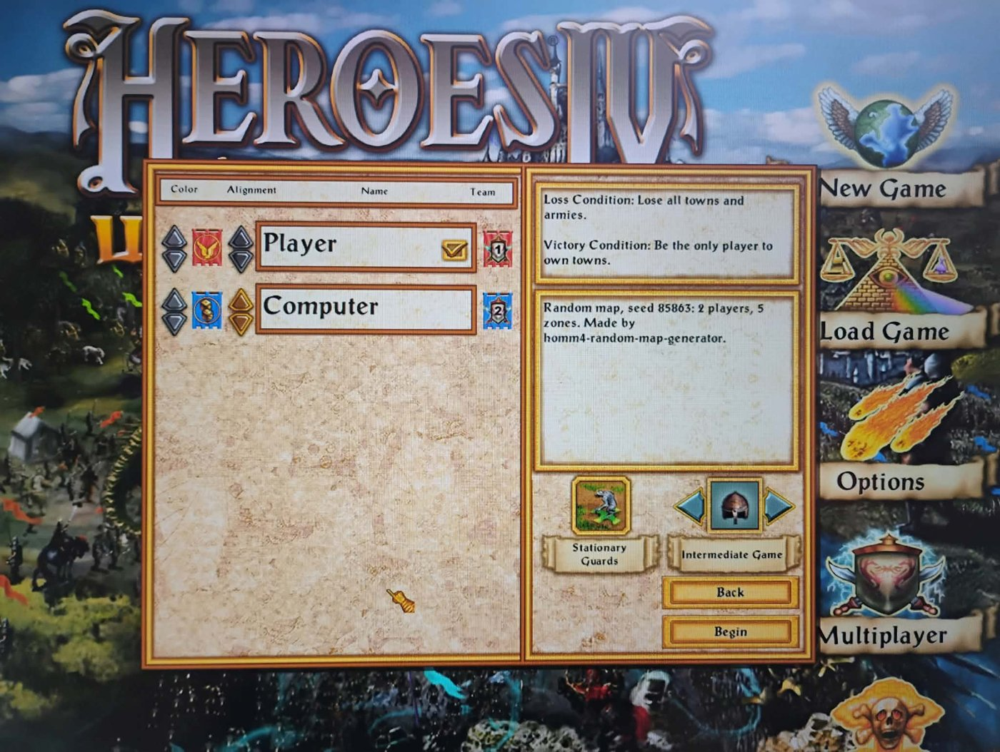
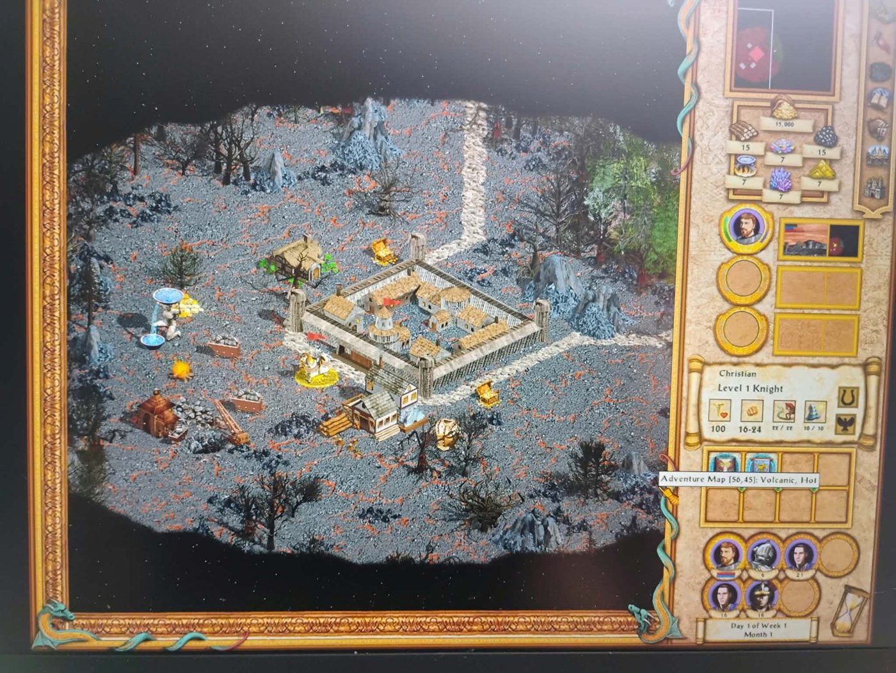

# HoMM4 Random Map Generator

**Random maps for Heroes of Might and Magic IV, in the spirit of the Heroes III random map generator.**
Pick a map size, the players, their factions and starting heroes, press **Create map**, and a brand-new
scenario is waiting for you in the game's scenario list.

[](https://github.com/tishonator/homm4-random-map-generator/releases/latest)
[](https://www.youtube.com/@TishGamer?sub_confirmation=1)

> [!CAUTION]
> You need your own copy of **Heroes of Might and Magic IV Complete** (for example the GOG edition).
> The program does not include or change any game files: it only writes new map files into the game's
> `Maps` folder.



Full-length demo video: [screenshots/demo.mp4](screenshots/demo.mp4)

Made by **Tihomir Ivanov** – **TishGamer** on YouTube. If you like it,
[subscribe to the channel](https://www.youtube.com/@TishGamer?sub_confirmation=1) for more Heroes content.

## Contents

- [Features](#features)
- [Download and first launch](#download-and-first-launch)
- [How to use](#how-to-use)
- [Screenshots](#screenshots)
- [What a generated map contains](#what-a-generated-map-contains)
- [Troubleshooting](#troubleshooting)
- [Building from source](#building-from-source)
- [Roadmap](#roadmap)
- [About the author](#about-the-author)
- [Support my work](#support-my-work)
- [Credits](#credits)

## Features

- **One click, new map:** small to extra large maps for 2 to 6 players, each one different.
- **Players your way:** for each player choose human or computer, the faction (Life, Order, Death,
  Chaos, Nature, Might or random) and the starting hero, picked from the game's own heroes.
- **Hero card:** portrait, class, starting skills with the game's icons (hover for the effect),
  statistics, morale and luck, the starting army with creature stats, and the biography.
- **Starting army:** heroes of a chosen faction start with that faction's two level-1 creatures.
- **My random maps:** a list of the maps you made. Select one to see its settings, change them and press
  **Update map**, or **Create map** to make a new map from them. Delete maps you no longer need.
- **Repeatable:** every map has a seed; the same seed and settings give the same map.
- **Easy to find in the game:** maps are named `_Random_Map_<number>` and appear at the top of the
  scenario list.
- **Single file, nothing to install:** builds for Windows, Linux and macOS.

## Download and first launch

1. Go to the [latest release](https://github.com/tishonator/homm4-random-map-generator/releases/latest)
   and download `HoMM4RandomMap-windows.exe` (Linux and macOS builds are there too).
2. Run it. Windows may show "Windows protected your PC" because the program is not signed: click
   **More info**, then **Run anyway**.
3. The program asks where Heroes IV is installed: the folder with `heroes4.exe` (for the GOG edition
   usually `C:\GOG Games\Heroes of Might and Magic 4 Complete` or similar). It checks the folder as you
   type and remembers it, so next time just press **Continue**. You can change it later with
   **Change...** in the main window.

## How to use

1. Choose the map size, the number of players and, if you like, a seed (empty = a new random map).
2. For each player choose human or computer, the faction and the starting hero. Picking a hero while the
   faction is Random selects that hero's faction. The hero card on the right shows the selected hero.
3. Press **Create map**. The program tells you the map's name, for example `_Random_Map_62001`.
4. Start Heroes of Might and Magic IV, choose **New Game**, then **Scenario**, pick the map at the top of
   the list and play.

To change a map you made, select it in **My random maps**, change the settings and press
**Update map**. **Deselect** (or Escape) goes back to a new map; **Delete** removes the map from the
game's `Maps` folder.

## Screenshots

| | |
|---|---|
|  |  |
| Choosing the game folder on the first start | Setting up the players and their heroes |
|  |  |
| The hero card: skills, statistics, army and biography | The map is ready, with the steps to play it |
|  |  |
| The random maps at the top of the scenario list | Starting the scenario |



## What a generated map contains

- One start zone per player with a town of the player's faction, the starting hero and army, a sawmill,
  an ore pit, a dwelling and some treasure.
- Neutral zones between them with rare-resource mines, gold mines, dwellings, shrines, scholars,
  creature banks, artifacts and treasure. Guards get stronger towards the middle of the map.
- Zones are walled with trees, rocks and mountains that match their terrain and joined by narrow
  passages, each guarded by a monster. Roads lead from each town to its passages.
- Every map is checked: all towns can be reached, and no start zone is left without a guard on its
  way out.

## Troubleshooting

- **The map is not in the scenario list:** check that the program uses the same game folder you start
  the game from (shown in the main window). Maps are saved in that folder's `Maps` subfolder.
- **"Heroes IV is not in this folder":** choose the folder that contains `heroes4.exe` (the dialog
  also accepts its parent folder or one of its subfolders, such as `Maps`).
- **Windows blocks the program:** see step 2 of [Download and first launch](#download-and-first-launch).
- **Something else:** open an [issue](https://github.com/tishonator/homm4-random-map-generator/issues)
  with the map name and what happened.

## Building from source

Needs Python 3.10 or newer (the window uses tkinter, which comes with Python).

```bash
python tools/setup_window.py                            # run the program
python tools/generator.py --seed 1112 --out <folder>    # the generator alone (see --help)
pip install pyinstaller
pyinstaller HoMM4RandomMap.spec                         # single-file program in dist/
```

GitHub Actions ([.github/workflows/build.yml](.github/workflows/build.yml)) builds the program for
Windows, Linux and macOS on every push. Pushing a version tag publishes the builds on the Releases page:

```bash
git tag v1.0.0
git push origin v1.0.0
```

<details>
<summary>Map format tools</summary>

```bash
python tools/h4c.py info  "<map>.h4c"
python tools/h4c.py unpack "<map>.h4c" out.bin
python tools/h4c.py pack   in.bin "<map>.h4c"
python tools/h4c.py retitle "<in>.h4c" "<out>.h4c" "New title"
python tools/preview.py "<map>.h4c" preview.png            # needs Pillow
python tools/h4full.py check "<maps folder>"               # decode + re-encode every map
python tools/build_data.py "<game>/Maps"                   # rebuild the data/*.json tables
python tools/footprints.py "<game>/Data" data/footprints.json
```

The map format is described in [research/format.md](research/format.md). Maps are saved as format 29 /
expansion 2 maps: the game groups the scenario list by expansion and sorts by name inside each group, so
the leading `_` puts them at the very top (see [tools/naming.py](tools/naming.py)).

</details>

## Roadmap

| Stage | Goal | Status |
|---|---|---|
| 0 | Read and write the `.h4c` map container | done |
| 1 | Decode the full map format (all 105 shipped maps decode and re-encode byte for byte) | done |
| 2 | Write maps from scratch: terrain, transitions, roads, objects | done |
| 3 | Generator: zones, terrain, obstacles, roads, towns, mines, guards, treasure | done |
| 4 | Single-file program with a setup window, built by GitHub Actions | done |
| 5 | Water and islands, underground level, templates, an in-game "Random map" button | planned |

## About the author

**Tihomir Ivanov** – gamer, Heroes fan and developer.

- YouTube: [TishGamer](https://www.youtube.com/@TishGamer) – Heroes of Might and Magic gameplay and mods
- GitHub: [tishonator](https://github.com/tishonator) – more fan mods and projects

## Support my work

If you enjoy the random map generator, you can support its development with a donation:

[](https://www.paypal.com/donate/?hosted_button_id=S88TKD55YVK7S)

Subscribing to [TishGamer on YouTube](https://www.youtube.com/@TishGamer?sub_confirmation=1) helps too.

## Credits

- This is an unofficial fan project, not affiliated with or endorsed by Ubisoft. Heroes of Might and
  Magic is a trademark of Ubisoft Entertainment.
- Map format knowledge builds on the reverse-engineering notes of [h4r](https://github.com/demen1n/h4r)
  (GPL-3.0). The code here is written independently.
